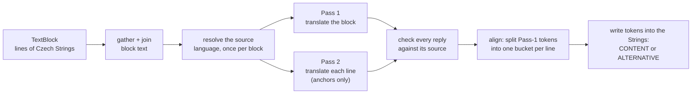

# How the translator works

For anyone who wants to understand what the translator does to a document, and why its output looks the way it
does. It answers how the source language is chosen, how replies are checked, how an ALTO page keeps its layout, how
vocabulary terms are kept, and what the three backends are. The flags and settings are in
[the command-line reference](reference/cli.md) and [configuration.md](configuration.md).

On this page: [Two entry points](#one-core-two-entry-points) · [The processing flow](#the-processing-flow) ·
[Where the output goes](#where-the-output-goes) · [Source language](#source-language-identification) ·
[Chunking](#chunking) · [Page-level batching](#page-level-batching) ·
[The degenerate-output guard](#the-degenerate-output-guard) ·
[ALTO dual-pass reconstruction](#alto-dual-pass-reconstruction) · [Metadata mode](#metadata-mode) ·
[Vocabulary protection](#vocabulary-protection) · [The three backends](#the-three-backends) ·
[Design limits](#design-limits)

## One core, two entry points

The translator runs as a batch command line and as an HTTP service, with the same processing behind both:

- **The batch CLI, `main.py`,** is made for large directories of documents. It writes a translated file, a
  translation log and a document record per document, and one paradata record per run.
- **The service, `service/api.py`,** is a FastAPI application whose `POST /translate` calls the same
  `main.process_single_file()` the CLI uses, without a second copy of the logic or of the model registry. It bounds
  every upload and request, and returns each call's provenance in its JSON and multipart answers
  ([service/README.md](../service/README.md)). Where the two still differ, and why:
  [usage.md](usage.md#the-command-line-and-the-service).

## The processing flow

1. **Routing.** The file's root element decides: `<alto>` is an ALTO page, any other root a metadata record
   (`utils.xml_kind`). `--alto`, `--xpaths` or `--formats` on the command line, or `is_alto` in a request, name the
   mode instead.
2. **Extraction.**
   - **ALTO:** the pages are read `Page` → `TextBlock` → `TextLine` → `String`, and each line's text is rebuilt
     from its `String` `CONTENT` attributes.
   - **Metadata:** the namespaces are extracted from the whole tree (needed for OAI-PMH envelopes and custom
     wrappers), and the elements the XPaths name are found. Any well-formed XML works.
3. **Language identification** (only with `--source_lang auto`): the document's language first, then each ALTO
   `TextBlock` (for every line in it) or metadata field
   ([Source-language identification](#source-language-identification)).
4. **Vocabulary protection** (when a vocabulary is loaded): with LINDAT, multi-word phrases are matched first, then
   single words by their UDPipe lemma, with a guard for grammatical number; matched terms become placeholders the
   model passes through, and are restored afterwards. The language-model backends get a glossary instead
   ([Vocabulary protection](#vocabulary-protection)).
5. **Chunking and translation.** Long texts are split at sentence boundaries ([Chunking](#chunking)); the page's
   pieces are sent in batches ([Page-level batching](#page-level-batching)), and every reply is checked against its
   source ([The degenerate-output guard](#the-degenerate-output-guard)).
6. **Reconstruction.** ALTO: each block's translation is realigned to the physical lines and `String`s
   ([ALTO dual-pass reconstruction](#alto-dual-pass-reconstruction)). Metadata: each field is replaced, or followed
   by its translation ([Metadata mode](#metadata-mode)).
7. **Output.** The translated `.xml` keeps every original tag and namespace. A per-document `_log.csv` pairs source
   and translation for review, the document record gets its `translations` block, and the run's paradata records
   what it used. Metadata output can be validated against an XSD ([outputs](reference/outputs.md)).

## Where the output goes

The translator is a terminal branch. It reads the per-page ALTO that ocr-postprocess writes
(`PAGE_ALTO/<doc>/<doc>-N.alto.xml`), and its output is an end product: an English edition of the page or record,
for readers and for publication. The later stages work on the original text (nlp-enrich reads `DOC_LINE_CATEG/` and
the original `ALTO/`), so no stage reads `TRANSLATED/`.

What persists in the pipeline is a reference: the document record names the translated file as
`derived_from.translated_xml`, and its `translations` block records how it was made. The files fan out from
ocr-postprocess and stop here, while the record runs on through every stage. The hub's
[pipelines page](https://ufal.github.io/atrium-project/pipelines/) draws both layers.

## Source-language identification

With `--source_lang auto` the pipeline never uses a raw FastText guess. On a real run over the Czech ALTO sample,
FastText answered `krc`, `yue`, `bod`, `epo` and `swh` for short OCR blocks (names, numbers, "Objednatel:"), and
every such guess used to become the block's source language: UDPipe had no model for it, page batches split per
bogus language, and `append` mode would have written it into the output as `LANG`. Whenever detection could not run
at all, the answer was `en`, the *target*, so the block was returned untranslated.

`processors/language.py::resolve_source_language` decides instead, taking the first rule that applies:

| # | Basis      | Used when                                                                                                                                                                                       |
|---|------------|-------------------------------------------------------------------------------------------------------------------------------------------------------------------------------------------------|
| 1 | `detected` | the text has at least `LANG_ID_MIN_LETTERS` (20) letters, and one of FastText's top-5 candidates scores at least `LANG_ID_MIN_CONFIDENCE` (0.5) **and** is a language the backend can translate |
| 2 | `hint`     | the element's own label (ALTO `LANG` or `language`, which ABBYY writes per block; metadata `xml:lang`) names a language the backend can translate                                               |
| 3 | `context`  | the language of the whole document, resolved once, up front, by rule 1 over its first `LANG_ID_DOCUMENT_CHARS` (20,000 by default) characters                                                   |
| 4 | `default`  | the default source language: `--default-source-lang` → `default_source_lang` (config.txt) → `DEFAULT_SOURCE_LANG` → `cs`                                                                        |

"Can translate" is derived from the backend: for LINDAT, the source side of every model pair that ends in the
target language (`cs, de, fr, pl, ru, uk` for English), plus the target itself, so a block already in English is
left as it is. For `openai_compatible` and `ct2` it is the languages listed in `LLM_LANGUAGES` or `CT2_LANGUAGES`.
`LANG_ID_LANGUAGES` narrows the set further. A segment longer than `LANG_ID_SEGMENT_CHARS` (2,000) is judged on its
first characters (a `sampled` note).

The detection model is `facebook/fasttext-language-identification`. Its ISO 639-3 labels are mapped to the ISO
639-1 codes the backends and UDPipe use (`ces→cs`, `slk→sk`, `deu→de`, `eng→en`, …), for 43 languages: those of
Europe that FastText distinguishes, plus Latin, Esperanto and Hindi. A label outside the map is never used as a
language code. Only letters are scored: the text is lower-cased and everything that is not a letter becomes a
space, since digits and punctuation are most of an OCR fragment and none of its language. If the model cannot be
loaded, nothing is detected and rules 2–4 decide; the service reports it on `GET /health?deep=true`.

Each document logs one line of what happened, as a warning when FastText guesses were overridden:

```text
MTX201501307_anon: source language — document cs (detected, FastText top guess cs 0.97);
  blocks: cs 1193 (hint 988, context 158, detected 47); FastText guesses not used: eo×11, bod×6, swh×6, krc×5, yue×3.
```

**A language the backend cannot translate** (translator#52). When FastText is confident (at least
`LANG_ID_MIN_CONFIDENCE`, on a text of at least `LANG_ID_MIN_LETTERS` letters) that a segment is a real language the
backend cannot translate (Latin taxa, a Hungarian passage on LINDAT), and no translatable candidate scored as well,
the segment still falls back through rules 2–4 and is translated from that language, but it is reported: its
`_log.csv` rows say `unsupported_lang`, the document record counts it in `translations.unsupported_source_langs`
(`{"hu": 1, "la": 2}`), and the document's log line ends with `identified as a language the backend cannot
translate, translated from the fallback: la×2, hu×1`. An untrustworthy guess (below the threshold, an exotic
FastText label such as `yue`, a text too short to judge) is not reported. A backend that does translate the
language (EuroLLM or MADLAD on `ct2`) simply uses the detection.

The resolved document language is recorded in the record (`translations.detected_source_lang`) and the policy in
the paradata. To tune the two thresholds on real data, `python -m eval.langid_report <file.alto.xml> > langid.csv`
lists, per block, FastText's top three guesses next to the resolved language and its basis; it honours the same
environment variables.

**On a single-language corpus, pass `--source_lang cs`.** No detection runs, and the CC BY-NC FastText model is not
loaded ([licences](reference/licences.md)).

**An explicit pair is checked before anything is translated.** A source and target the backend cannot translate is
refused, never rerouted: the CLI exits 1 and the service answers 422 (`unsupported_language_pair`), each naming the
pairs the backend offers. With `auto`, the default source language is checked the same way. Codes such as `CS`,
`cs-CZ` or `ces` are read as `cs`. Before 2026-10-18 LINDAT translated such a run from Czech into English without a
word ([The three backends](#the-three-backends)).

## Chunking

Texts longer than `TRANSLATION_CHUNK_CHARS` (4,000 characters by default) are split before they are sent. In each
window the highest-priority boundary found wins, tried in strict order: newline (`\n`), then sentence-final
punctuation (`. `, `! `, `? `), then clause punctuation (`; `, `, `), then a word boundary, and a hard cut only for a
single oversized token. Whole sentences stay together, which keeps the model's context and the quality of the
translation; mid-word truncation does not occur. The pieces are re-joined with a line break and the split is
recorded (a `split` note in `limits_applied`). The same chunker (`processors/chunking.py`) feeds the UDPipe
lemmatiser.

## Page-level batching

To cut network latency and the load on the backend, an ALTO page is translated in batches rather than one
`TextBlock` and `TextLine` at a time. The pipeline gathers all the text elements of a page, groups them by their
source language, and sends each group as one payload separated by newlines.

- **Fewer requests.** A block of N lines used to cost 1 + N requests; a page now costs as few as two per language
  group: one for the blocks, one for the line anchors. Moving from per-block to per-page calls (v0.8.0) cut the
  number of calls about twentyfold.
- **A batch is trusted only when it is plausible.** A batched reply is accepted only if it keeps the request's line
  count **and** every line is a plausible translation of its own item ([the guard](#the-degenerate-output-guard)).
  If the model merges or drops line boundaries, or answers any item with a loop, an empty line or a runaway or
  truncated one, the line mapping of that reply is not trusted and the whole batch falls back to one request per
  item.
- **Anchors only where they matter.** The line-anchor pass is sent only for translated blocks of at least two text
  lines; a single-line block takes its block translation as it is.

Each document's log ends with a summary counting clean batches, line-count mismatches, implausible replies,
transport errors, flagged and recovered segments, and lines placed by word count, as a warning whenever anything
other than clean batching happened, so a slow run explains itself.

## The degenerate-output guard

A backend can answer HTTP 200 with something that is not a translation. On the 2026-09-26 sample refresh about a
third of all LINDAT replies were one Czech word repeated up to about 150 times (`"pravidla pravidla …"`), for
one-word headings and whole sentences, on the ALTO and the metadata path, and nondeterministically. Nothing looked
at the content of a reply, so the garbage went into the XML and the log, and, through the ALTO line anchors, which
are never logged, into the word-to-box alignment of every block on the page (2,489 blanked `String`s instead of
224). What was found behind it, and how the endpoint is watched: [LINDAT's replies](evaluation/lindat-replies.md).

Every translated segment is now checked against its own source by `processors/quality.py::degeneration_reason`.
Each rule compares with the source, so dot leaders, number tables and names kept verbatim pass:

| Check         | Rejects                                                                                                  |
|---------------|----------------------------------------------------------------------------------------------------------|
| empty         | no text, for a source with a letter or digit                                                             |
| runaway       | more than three times the source's tokens, plus eight                                                    |
| truncated     | under a fifth of the source's tokens, for a source of ten tokens or more                                 |
| repetition    | a unit of one to three tokens repeated four or more times in a row, more than the source repeats it      |
| dominance     | one token filling half the output and at least six times, where it does not in the source                |
| all identical | a multi-token output that is one token over and over, for a source that is not                           |
| mixed script  | a word that mixes Latin and Cyrillic letters, such as `Ostrůв`                                           |

What happens to a rejected reply:

1. **Backend re-request.** `LindatTranslator` re-requests a degenerate reply up to `LINDAT_GUARD_RETRIES` times
   (default 2), the first time **immediately**, then with back-off. The LLM and `ct2` backends reject it in their
   own output guards (their length ratios, `*_GUARD_*`).
2. **Flag.** A block, line anchor or metadata field that is still unusable is **flagged** and left alone for now.
3. **Re-run during the same document.** After the whole document, the flagged segments are requested again one by
   one, after a cool-down (`TRANSLATION_RERUN_ROUNDS`, default 1; `TRANSLATION_RERUN_DELAY_S`, default 10 s). The
   `ct2` backend decodes deterministically, so the same request would get the same reply; in a re-run round it
   searches a wider beam instead (NMT families 4, 6, 8, … up to 12; EuroLLM leaves greedy decoding for a beam of
   4, 6, …). That is still deterministic, so a run can be reproduced. Whether it recovers more segments on real
   EuroLLM output has not been measured. A recovered segment is logged `rerun`.
4. **Keep the source.** A segment that never recovers keeps its source text (ALTO `String`s keep their `CONTENT` and
   geometry; a metadata field is not overwritten and gets no appended sibling) and is logged `untranslated` in the
   `status` column of the `_log.csv`. The file is still written: one bad reply costs one segment, never the
   document.

A per-document summary line, a warning when anything was flagged or fell back, reports batches accepted, fallbacks
by cause, segments flagged, recovered and left untranslated, and lines placed by word count. `main.py` adds one
line per document with the number of LINDAT replies rejected and re-requested (`[WARN] LINDAT: N degenerate
reply(ies) re-requested …`); the paradata of both entry points records the count as `lindat_degenerate_replies`.
The individual rejections are logged at INFO unless the retry fails too.

The guard's rules were calibrated at no false flag on all 1,193 ALTO blocks of June and the 37 metadata fields,
with every looping one caught; the mixed-script rule on the 4,264 logged rows of `data_samples/`, where its one hit
is the `Ostrůв` that a self-hosted run had logged `ok`. Any other `TranslationError` (transport, configuration)
still fails the whole file. How a backend takes part: [the backend interface](development.md#the-backend-interface).

## ALTO dual-pass reconstruction

ALTO stores text spatially: each `TextLine` holds a sequence of `String` elements, and each `String` carries one
token in its `CONTENT` attribute, with its position. Translating line by line loses the context across lines and
gives poor output; translating only the whole block gives fluent text but discards the line and `String` structure
that has to be kept. The translator does both and uses the second pass only as a ruler.



Per `TextBlock` (`process_alto_xml` and `_align_tokens_to_lines` in `utils.py`):

1. **Gather.** For every `TextLine` in the block, collect its `String` elements and rebuild the line's text by
   joining their `CONTENT` values.
2. **Aggregate.** Join all the line texts into one block-level string.
3. **Resolve the language** (with `--source_lang auto`) **once for the whole block**, so every line of the block
   is translated from the same language; a block FastText cannot judge reliably takes its `LANG` label or the
   document's language ([Source-language identification](#source-language-identification)).
4. **Pass 1, the block translation.** Translate the full block text, all blocks of a page in one batched request
   ([Page-level batching](#page-level-batching)). This is the fluent translation whose tokens are written back.
5. **Pass 2, the line translations.** Translate each non-empty line of every translated block that has at least
   two text lines, batched per page. These translations are **not** written to the output; they are structural
   anchors that tell the aligner roughly how many words each physical line should receive.
6. **Validation, flagging, re-run.** Every block translation and every anchor is checked against its own source
   ([the guard](#the-degenerate-output-guard)). A block or anchor that is still unusable is flagged, and all
   flagged segments are re-run after the last page. A block that never recovers keeps its source text and is not
   redistributed at all.
7. **Alignment and redistribution.**
   - `_align_block` divides the Pass-1 block tokens into one bucket per line. An anchor is used only if it is a
     plausible translation **of its own source line**; then a sliding window of ±50 % around the anchor's word
     count picks the split point that maximises `difflib.SequenceMatcher` similarity against the anchor. A line
     whose anchor is empty, looping, runaway or truncated instead gets a **share of the remaining tokens in
     proportion to the remaining source word counts** (logged `approx_alignment`), so one bad anchor can neither
     starve nor flood its neighbours. No line with source text is left empty while tokens remain, and the **last
     line with source text** takes the remainder.
   - A block whose translation has **fewer words than it has lines of text** cannot be split at all: a split only
     cuts the translation, never inserts into it, so every line after a missing word would show its neighbour's
     text and the last lines none. That is a table column whose repeated cells the model merged (page 76 of the
     sample: 42 numbers came back as 39). Each line then takes **its own line translation**, the anchor (`76` →
     `76`); a line without a usable one keeps its source text and is logged `untranslated`. The per-document
     summary names such blocks. Prose never reaches this rule, because its lines hold many words each.
   - Within each line, the bucket's tokens are distributed over the line's `String` elements **one to one, in
     order**: each `String` except the last gets one token (an empty string once the bucket is exhausted), and the
     **last `String` of the line takes all the remaining tokens**.
   - The values go into `CONTENT` in `replace` mode, where an existing block `LANG` becomes the target language,
     or into an `<ALTERNATIVE PURPOSE="translation:<lang>">` child of the untouched `String` in `append` mode.

Translated words therefore never cross line boundaries, every `String` keeps its original position, and no token of
the block translation is lost.

**The word-to-box correspondence is constructed, not observed.** Because tokens are bucketed per line, a `String`
can end up empty or holding several words; no box is ever resized. This is as true of the `ALTERNATIVE` in `append`
mode as of `CONTENT` in `replace` mode: it says which English landed on that box, not what that word means. Read
translated ALTO line by line, not word by word. `append` keeps the scanned `CONTENT`, so the source text and its
geometry survive beside the translation; ALTO 3.1 declares `ALTERNATIVE` with a free-text `PURPOSE` for this, so
the output stays schema-valid.

**Why the anchors are validated.** The 2026-09-26 refresh showed what an unvalidated anchor does. With page-level
batching the anchors are one request per page; a degenerate reply filled some anchor slots with 50 or more words
and left the others empty, and the aligner, trusting the anchors, turned that into lines holding 71 words next to
lines holding none, invisibly, since anchors are never logged.

**Cost per page:** normally **two** batched requests per language group (blocks and anchors). A fallback costs one
request per block or line on that page; a flagged segment costs up to `LINDAT_GUARD_RETRIES` re-requests plus
`TRANSLATION_RERUN_ROUNDS` re-runs. With a vocabulary loaded, each request also goes through Tag-and-Protect.

Edge cases:

- A block with a **single text line** skips the alignment search: all its tokens go to that line.
- Lines whose original text is empty get an empty bucket, and no anchor translation.
- If Pass 1 yields **fewer** tokens than there are `String` elements in a line, the trailing `String`s get an empty
  `CONTENT` (in `append` mode, no `ALTERNATIVE`); if it yields **more**, the surplus goes into the line's last
  `String`.
- **`--fast-align`** skips Pass 2 and places every line by its source word count, with no per-line requests, at the
  price of slightly coarser line splits. It has no line translations to fall back on, so every line of a block with
  fewer words than lines is logged `approx_alignment`, and so is any line with source text that the word-count split
  leaves empty.

## Metadata mode

Used for any XML that is not ALTO; in practice AMČR records, bare or inside an OAI-PMH `GetRecord` envelope.

1. **Parse safely.** The parser resolves no entities, loads no DTD and makes no network requests, so an uploaded
   file cannot pull in external content.
2. **Find the namespaces.** The whole tree is scanned, recursively, for the namespace URIs; the AMČR and OAI-PMH
   ones are bound to the prefixes `amcr:` and `oai:` whatever prefixes the file itself uses, so the same XPaths
   work on a bare record and on one wrapped in an envelope.
3. **Select the fields.** Each XPath from `amcr-fields.txt` (or `--xpaths`) is evaluated; every matching element with
   non-empty text is one unit of translation.
4. **Resolve the language, per field.** With `auto`, the record's language is resolved once from all of its
   targeted fields, and each field on its own under the same rules; a field too short or too ambiguous inherits the
   record's language.
5. **Write back.** In `replace` mode the element's text is overwritten. In `append` mode a sibling with the same tag
   and attributes is inserted after it, marked `xml:lang="<target>"`, and the original is marked with its source
   language if it had no `xml:lang`: the bilingual shape AMČR uses for its own thesaurus. Every reply passes the
   [guard](#the-degenerate-output-guard) first; a field that never recovers is left untouched.
6. **Save.** Everything else (other elements, attributes, comments, whitespace) is left as it was; the file is
   written without re-indentation, so a diff against the source shows only the translated fields.

`append` is idempotent: a field that already has a target-language sibling, or is itself one, is skipped without a
request. `--xsd` (the service: `XSD_PATH`) validates the finished file, for an OAI-PMH response each record inside
the envelope, and reports a failure as a warning; strict, as a failed document (exit 3) or a 422. AMČR 2.2 rejects
the `append` shape
([Choose the output mode](usage.md#choose-the-output-mode-replace-or-append)).

## Vocabulary protection

Archaeological terms have fixed English equivalents that a general translation model does not know. The translator
keeps them fixed by one of two mechanisms, chosen by the backend. Without a vocabulary neither runs: no UDPipe call
is made and no lemmatisation is done.

**Tag-and-Protect, with `lindat`.** CUBBITT accepts no glossary, so the terms are shielded from the model:

1. **Multi-word phrase pass.** Phrases containing spaces (`fotografie události`) are matched case-insensitively as
   whole words, never inside a longer word, longest phrase first. **Every** occurrence is replaced with its own
   placeholder and counted in the protected-term statistics. Phrases match on the surface form stored in the CSV,
   not by lemma.
2. **Single-word lemma pass.** The remaining text is lemmatised by the LINDAT UDPipe service, and tokens whose base
   form is in the vocabulary are replaced the same way. Only source languages with a UDPipe model are lemmatised
   ([the models](reference/vocabulary.md#the-lemma-form-by-language)); for any other language this pass is skipped,
   with one warning per language, instead of running the text through the Czech model, whose lemmas would be noise
   that can still collide with a Czech key. A **number-agreement guard** protects only singular or number-neutral
   occurrences; a plural source token is left for the model to inflect, because the vocabulary stores singular
   English terms and freezing one onto a plural would break agreement ("several feature").
3. **Translation.** The tagged text is sent to the translation service; the models leave the placeholders alone.
4. **Restoration.** Every placeholder in the translation is replaced with its vocabulary translation: exactly, then
   case-insensitively, then tolerating spaces the model inserted inside it. Any placeholder debris left over is
   removed before the text is written or logged.

The placeholder is a purely alphabetic marker, `Xtermzzz<N>z`. Earlier versions wrapped terms in `__TERM_N__`, which
the models often mangled at the underscores and digits.

**A glossary in the prompt, with `openai_compatible` and with `ct2` EuroLLM.** The vocabulary entries found in the
text (at most `LLM_MAX_GLOSSARY_TERMS` or `CT2_MAX_GLOSSARY_TERMS`, 40 by default, the longest kept) are sent with the
request as `source = target` lines in the system message, with an instruction to use exactly those terms. No UDPipe
call is needed. `LLM_GLOSSARY_DESCRIPTION_CHARS` (default 0, none) adds each matched term's description,
`kostel = church (description: …)`, as context for the sense; the prompt says it never belongs in the translation.
Only `openai_compatible` uses descriptions. A glossary that EuroLLM writes back into its reply is cut from it; a reply
that was only the glossary, or the untranslated source, is requested once more without the glossary.

The `ct2` NMT families, MADLAD-400, NLLB-200 and Opus-MT, translate without vocabulary control. The vocabulary's
format: [reference/vocabulary.md](reference/vocabulary.md).

## The three backends

| Name                   | Class              | Glossary                                         | Configured by                                                                                                                                              |
|------------------------|--------------------|--------------------------------------------------|------------------------------------------------------------------------------------------------------------------------------------------------------------|
| `lindat` (the default) | `LindatTranslator` | no; Tag-and-Protect instead                      | `TRANSLATION_URL`, defaulting to LINDAT's CUBBITT API. The model list is read **live** from the API's `/models` and composed as `<src>-<tgt>`              |
| `openai_compatible`    | `LLMTranslator`    | in the prompt, with optional descriptions        | `LLM_BASE_URL`, `LLM_MODEL`, `LLM_API_KEY`, optional `LLM_PROVIDER`, `LLM_LANGUAGES`, `LLM_EXTRA_BODY`. Raw REST, no vendor SDK; no model id is hard-coded |
| `ct2`                  | `CT2Translator`    | in the prompt for `eurollm`; none for NMT models | `CT2_MODEL_DIR`, `CT2_MODEL_FAMILY` (`eurollm`, `madlad`, `nllb`, `opus`), `CT2_SP_MODEL`, `CT2_DEVICE`, `CT2_COMPUTE_TYPE`; needs `requirements-ct2.txt`  |

The selection order is `--backend` → `translation_backend` in config.txt → `TRANSLATION_BACKEND` → `lindat`; an
unknown name raises, with the list of available ones. Every setting: [configuration.md](configuration.md).

**LINDAT stays the default; the self-hosted alternative is Qwen3.8-27B through `openai_compatible`.** The bake-off
of 2026-10-19 found it close to LINDAT on every measured check, and `ct2` with EuroLLM no longer recommended
([the decision](decisions/backend-choice.md), [the evidence](evaluation/backends.md)). The `ct2` backend stays for
MADLAD-400, NLLB-200 and Opus-MT, which the pilot does not measure. Its heavy imports (`ctranslate2`,
`sentencepiece`) load on first use and fail with an install hint when `requirements-ct2.txt` is missing; the model
loads and runs one short generation at start-up, so a model that cannot run stops the run there, with the fix.

**Which languages.** `lindat` offers the `<src>-<tgt>` pairs the LINDAT API lists, falling back to a built-in list
of six pairs into English (`cs`, `de`, `fr`, `pl`, `ru`, `uk`) when the API cannot be reached; it is Czech-centric
and has, for instance, no `cs-it` or `hu-en`. `openai_compatible` and `ct2` offer the languages in `LLM_LANGUAGES` /
`CT2_LANGUAGES`; the LLM backend lists nothing unless `LLM_LANGUAGES` is set, so it refuses nothing.

**A pair the backend cannot translate is refused, never rerouted** (2026-10-18). LINDAT used to send any pair it has
no model for to `cs-en` without a word, so `cs→it` wrote English into `_it.xml` and `hu→en` translated Hungarian as
Czech. Now `language_pair_problem()` (`processors/language.py`) checks an explicit pair before anything is
translated; LINDAT is held to its exact `src-tgt` models, another backend to `supported_languages()` when that lists
anything. `_basic_translate` raises `UnsupportedLanguagePairError` as the backstop. The narrower a backend's set, the
more `unsupported_lang` rows an `auto` run over mixed material has: LINDAT lacks `la` and `hu`; EuroLLM and MADLAD
have both.

Each backend brings its own components and their licences into the run's record
([licences](reference/licences.md)).

## Design limits

These follow from how the tool works:

- **Word boxes in translated ALTO are approximate.** Line boundaries are exact; the placement of words within a line
  is constructed (above).
- **ALTO output is not validated by the tool.** `--xsd` applies to metadata output only; ALTO output of either mode
  is valid against ALTO 3.1.
- **AMČR `append` output is not valid AMČR 2.2.** Use `replace` where the record must validate.
- **No RO-Crate is produced by a run.** `atrium_rocrate.py` is a separate step, run over finished records
  ([outputs](reference/outputs.md)).
- **Language coverage is the backend's.** CUBBITT is Czech-centric; other pairs need another backend.
- **`entities[].translation_en` is not produced,** since entities are created later in the pipeline.
